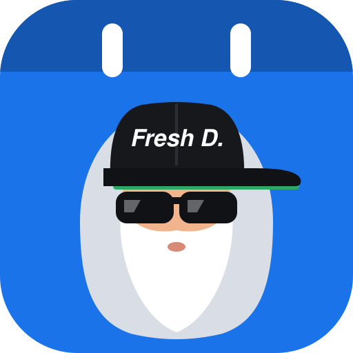
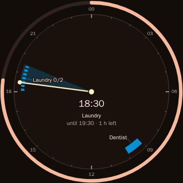

# Fresh-D's Kalender

> Trag ein, trag aus, macht mir nix aus!

Yo. This is a calendar and task-list app that sits on top of your Google Calendar. I made it for people with ADHD, because
the calendars I tried either showed me a pretty grid and then let me forget everything in it, or made me feel bad about
every task I didn't finish.

So here, time is something you can see (a "now" line, how long is left, when the next thing starts), reminders are
gentle, an unfinished task just moves to today instead of turning red, and the screen can be as calm as you want it.
Your events stay in Google Calendar. The app adds the parts I was missing, and it does not mind if you open it
three days late.

## What it does

- **Task lists live in the calendar.** Put a to-do list on a day or a time, tick things off right there, start new
  ones from templates. What you didn't finish carries over to today, no red, no shame.
- **Time you can see.** What is running or coming up shows the time left or when it starts, and there is a clock view
  that draws your day as a ring.
- **Bedtime mode.** Tell it when you want to sleep and the day shows a moon when it's time to wind down.
- **Birthdays**, including the ones from your Google Contacts, in their own Birthdays calendar.
- **Widgets.** Your week on the Android home screen. On iPhone you get home-screen and lock-screen widgets through the
  free Scriptable app.
- **Works offline.** Everything you see is kept on your device. Changes you make without a connection are sent when you
  are back online.
- **German and English**, light and dark, and a few themes with seasonal scenes. There is also a third language, a
  German in the voice of Fresh D., the headmaster who tries far too hard to be a rapper. Pick it in the language
  setting if you want the app to talk like that. Digga.

Almost everything can be switched on or off in the settings, and your settings follow you to every device. Yes, there
are a lot of settings. I regret nothing.

<!-- TODO: more phone screenshots (day, week, month) once pictures with demo data exist. -->

## How to get it

Honest version: there is no app store listing and no public server. You run your own instance (or use one someone you
trust runs for you), for example at `https://cal.example.org`. How to set one up is in
[docs/DEPLOYMENT.md](docs/DEPLOYMENT.md).

- You need a Google account; the calendar you see is your Google Calendar.
- **Android:** download the app (APK) from your instance under Settings › Account & app and install it.
- **iPhone:** open your instance in Safari and use "Add to Home Screen". The widget is set up under
  Settings › Account & app › iPhone widget and needs the free Scriptable app.
- **Anything else:** open the instance in a browser. It installs as an app there too.

## Yes, a bot wrote it (fresh, I know)

All of the code was written by AI agents, under my direction. I mostly say "no, the other thing" a lot. It's spec-first and test-first, so I know what it should
do and that the tests agree, but no experienced human has read it line by line. Use it at your own risk, lol, and
don't make it your only copy of anything important.

## For developers

Behaviour is written down as Gherkin scenarios in `spec/features/`, and those same files run as the end-to-end tests.
The code is a Vue 3 web app, a Hono server, shared code and an Android shell. You can try it locally without Google,
with a mock calendar and demo data.

- [docs/DEVELOPER-GUIDE.md](docs/DEVELOPER-GUIDE.md): run it locally, project layout, deploy your own instance
- [CONTRIBUTING.md](CONTRIBUTING.md): commands, gates, how to contribute
- [docs/DEPLOYMENT.md](docs/DEPLOYMENT.md): settings, Google setup, Android build and signing
- [AGENTS.md](AGENTS.md): rules for AI coding agents
- [docs/adrs/](docs/adrs/) (decisions) and [spec/](spec/) (features, REST API)
- [docs/ADHD-RESEARCH.md](docs/ADHD-RESEARCH.md): the research behind the design

## License

See [CONTRIBUTING.md](CONTRIBUTING.md) and [SECURITY.md](SECURITY.md).
This is an unofficial fan project. It is not affiliated with or endorsed by coldmirror.
Licensed under the [GNU Affero General Public License v3.0](LICENSE) (AGPL-3.0-only).
